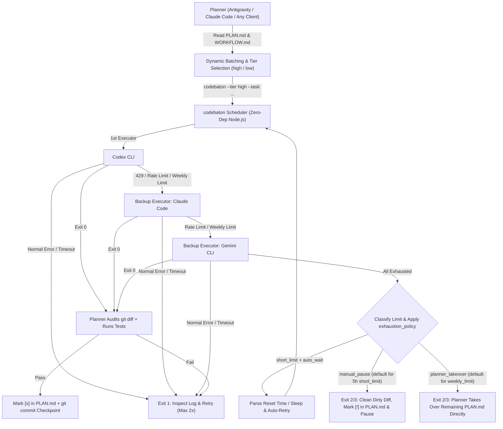

# codebaton

**Pass the coding baton across any AI CLI—with automatic failover and zero lost context.**

English | [简体中文](README.zh-CN.md)

---

`codebaton` is a lightweight, **zero-dependency**, client-decoupled local multi-agent (**Planner + Executor**) relay scheduler. Pair any AI coding CLI—such as **Antigravity / Gemini**, **Claude Code**, **Codex CLI**, or custom local wrappers—into a resilient coding pipeline featuring:

- **Dynamic task batching**: Single-step dispatch for high-risk core logic; 2–3 task bundling for low-risk boilerplate.
- **Capability tier routing (`high` / `low`)**: Dynamically maps abstract tiers to the right model per CLI.
- **Layered rate-limit detection & automatic failover**: Distinguishes **5-hour rolling / short-term limits** (`short_limit`) from **weekly / billing hard quotas** (`weekly_limit`), handing off automatically along `executor_chain`.
- **3-mode exhaustion policy**: Independently configure **`planner_takeover`**, **`manual_pause`**, or **`auto_wait`** (with smart reset-time parsing & automatic retry) for both short-term and weekly limits.
- **Cross-client checkpoint resume**: Git commits + `PLAN.md` preserve exact state so any Planner client can resume seamlessly with zero lost context.
- **Safe coexistence with `AGENTS.md` / `CLAUDE.md`**: Three-layer anti-collision protection (idempotent marker append, `[CODEBATON_EXECUTOR_MODE]` preamble, and hard `CODEBATON_DEPTH` recursion lock).

---

## Architecture & Relay Flow



---

## Quick Start

### Requirements
- **Node.js ≥ 18** (zero external npm dependencies; `dependencies: {}`)
- **macOS or Linux** + `git`
- One or more AI coding CLIs installed locally (e.g., `codex`, `claude`, `gemini`)

### 1. Clone & Link (Optional Global Command)

```bash
git clone https://github.com/wenzhang1/codebaton.git
cd codebaton

# Zero dependencies to install! Link globally so any repo can call `codebaton`:
npm link
```

### 2. Try Built-in Mock Relay (Zero API Cost)

```bash
# Simulate Codex hitting a 5-hour 429 rate limit -> automatic handoff to Claude
codebaton --mock failover --tier high --task "Implement JWT refresh middleware"

# Simulate all executors hitting weekly quota -> exit 3 + next_action=planner_takeover
codebaton --mock weekly-limit --tier high --task "Migrate database schema"

# Simulate auto_wait recovery -> sleeps 1s and auto-retries to exit 0
codebaton --mock auto-wait --tier low --task "Add unit tests"
```

### 3. Initialize Into Your Target Project

```bash
./scripts/init.sh /path/to/your-project --adapter all
# Options: --adapter antigravity | claude-code | all | none
```

`init.sh` safely creates:
- `codebaton.config.json` (never overwrites existing without `--force`)
- `.codebaton/WORKFLOW.md` (standard Planner rules)
- `PLAN.md` (task board & checkpoint recovery log)
- `.agent/rules/codebaton.md` (Antigravity adapter)
- Appends a clean marker block (`<!-- codebaton:start --> ... <!-- codebaton:end -->`) to `CLAUDE.md` without overwriting your existing rules, plus `.claude/settings.json` allowlist (if not already present)
- Appends `.codebaton/logs/` and `.codebaton/state.json` to `.gitignore`

### 4. Dry-Run Verify

```bash
cd /path/to/your-project
codebaton --dry-run --tier high --task "Verify executor chain and model routing"
```

---

## Configuration Reference (`codebaton.config.json`)

See [`codebaton.config.example.json`](codebaton.config.example.json) for the full template.

### Core Sections

```json
{
  "executor_chain": ["codex", "claude", "gemini"],
  "tiers": {
    "high": {
      "codex": "gpt-5.3-codex",
      "claude": "claude-opus-4-6",
      "gemini": "gemini-2.5-pro"
    },
    "low": {
      "codex": "gpt-5.1-codex-mini",
      "claude": "claude-sonnet-4-6",
      "gemini": "gemini-2.5-flash"
    }
  },
  "commands": {
    "codex": ["codex", "exec", "-m", "{{model}}", "{{task}}"],
    "claude": ["claude", "-p", "--model", "{{model}}", "{{task}}"],
    "gemini": ["gemini", "-p", "-m", "{{model}}", "{{task}}"]
  }
}
```

> **Safe Command Templates:** `commands` supports both **argv arrays** (recommended—executed with `shell: false`, 100% immune to quote/backtick/newline/`$VAR` corruption) and **string templates** (e.g., `"codex exec -m {{model}} \"{{task}}\""`, safely tokenized or POSIX-quoted automatically).

### 3-Mode Exhaustion Policy (`short_limit` vs `weekly_limit`)

`codebaton` matches CLI failures against `weekly_limit_patterns` first, then `rate_limit_patterns`. When all executors in `executor_chain` are exhausted, it applies your configured policy:

```json
"exhaustion_policy": {
  "short_limit": "manual_pause",
  "weekly_limit": "planner_takeover",
  "auto_wait": {
    "poll_interval_seconds": 900,
    "max_wait_seconds": 21600,
    "buffer_seconds": 30,
    "on_timeout": "manual_pause"
  }
}
```

Both `short_limit` (5-hour rolling window / 429 / RPM) and `weekly_limit` (weekly / monthly / billing quota) accept all **3 modes**:

| Policy Mode | Behavior | Recommended Use |
| :--- | :--- | :--- |
| **`"planner_takeover"`** | Emits `next_action=planner_takeover`. Planner immediately finishes remaining `PLAN.md` tasks with its native tools. | **Default for `weekly_limit`** (quota won't reset for days) |
| **`"manual_pause"`** | Emits `next_action=manual_pause` + `reset_hint`. Planner cleans dirty diff, marks `[!]` in `PLAN.md`, and pauses for you to resume manually. | **Default for `short_limit`** (wait for 5h window) or users who want to protect Planner quota on `weekly_limit` |
| **`"auto_wait"`** | `codebaton` parses reset time from CLI stderr (or uses `poll_interval_seconds`), sleeps up to `max_wait_seconds`, and automatically retries the chain. Falls back to `on_timeout` if still exhausted. | Unattended / overnight runs waiting through a 5-hour rolling reset |

### CLI Flags & Exit Codes

| Flag | Description |
| :--- | :--- |
| `--tier <high\|low>` | Capability tier to route (required for task dispatch) |
| `--task "<text>"` | Inline task prompt |
| `--task-file <path\|->` | Read multi-line prompt from file or stdin (`-`) |
| `--executor <name>` | Force a single executor (no chain failover) |
| `--config <path>` | Custom config file path |
| `--dry-run` | Show resolved chain, models, and commands without executing |
| `--mock [scenario]` | Zero-API demo (`failover`, `success`, `short-limit`, `weekly-limit`, `error`, `auto-wait`) |
| `--status` | Inspect active cooldowns in `.codebaton/state.json` and policies |
| `--reset-state` | Clear saved cooldowns immediately |
| `--ignore-cooldown` | Bypass active cooldowns for this run |
| `--no-prefix` | Omit `executor_prompt_prefix` for this run |

| Exit Code | Meaning |
| :---: | :--- |
| **`0`** | Task executed successfully by an Executor |
| **`1`** | Normal failure (code/build error, timeout, config error, or blocked nested call) — **no failover** |
| **`2`** | All executors unavailable/exhausted, with at least one **short-term / 5-hour** limit |
| **`3`** | All usable executors exhausted by **weekly / hard quota** limits |

On exit `2` or `3`, `codebaton` always prints a machine-readable directive to `stderr`:

```text
[codebaton] RESULT exit=3 limit_type=weekly_limit next_action=planner_takeover reset_hint="resets on Monday" executors=codex:weekly_limit,claude:weekly_limit,gemini:weekly_limit
```

---

## Safe Coexistence with Existing `AGENTS.md` / `CLAUDE.md`

When a Planner invokes an Executor (e.g., `claude` or `codex`) inside the same repository, the Executor automatically reads the project's `AGENTS.md` / `CLAUDE.md`. `codebaton` prevents role confusion and recursive loops via three layers:

1. **Non-destructive initialization**: `scripts/init.sh` never overwrites `CLAUDE.md`; it appends/updates a short marker block (`<!-- codebaton:start --> ... <!-- codebaton:end -->`).
2. **Automatic Executor preamble**: Prepends `[CODEBATON_EXECUTOR_MODE]` instructing the Executor to follow the repo's coding conventions while editing files directly and never touching `PLAN.md`.
3. **Hard recursion lock**: `codebaton` injects `CODEBATON_ROLE=executor` and `CODEBATON_DEPTH=1` into child environments and immediately blocks any nested `codebaton` call.

---

## Common Relay Scenarios

1. **Antigravity (Planner) → Codex → Claude → Gemini (Executors)**
   - Antigravity decomposes architecture into `PLAN.md`, dispatches high-complexity tasks with `--tier high` and boilerplate with `--tier low`, audits every `git diff`, runs tests, and commits checkpoints.
2. **Claude Code (Planner) → Codex → Gemini (Executors)**
   - Install with `--adapter claude-code`. Claude Code stays focused on planning and verification while delegating heavy implementation loops to Codex and Gemini.
3. **5-Hour Limit Pause vs Weekly Limit Takeover**
   - When Codex + Claude + Gemini all hit 5-hour limits (`exit 2`), `PLAN.md` marks `[!]` with the reset hint (or auto-waits if `short_limit: "auto_wait"`).
   - When all external CLIs hit weekly quota (`exit 3`), the Planner receives `next_action=planner_takeover` and finishes the remaining `PLAN.md` tasks seamlessly.
4. **Cross-Client Handoff**
   - Close Antigravity, open Claude Code (or vice versa), point it at `.codebaton/WORKFLOW.md` + `PLAN.md`. Git history + `PLAN.md` Recovery Log restore 100% of context immediately.

---

## Adding a New AI CLI Executor

Adding any CLI (e.g., Aider, OpenCode, Qwen Code, or a custom script) requires **zero code changes**—just add it to `codebaton.config.json`:

```json
{
  "executor_chain": ["codex", "opencode", "claude"],
  "tiers": {
    "high": { "opencode": "openai/gpt-5.3" },
    "low":  { "opencode": "openai/gpt-5-mini" }
  },
  "commands": {
    "opencode": ["opencode", "run", "--model", "{{model}}", "{{task}}"]
  }
}
```

---

## Running the Test Suite

Run the full 16-case zero-API-cost mock test suite:

```bash
npm test
# or directly:
node tests/run-tests.mjs
```

---

## License

[MIT](LICENSE)
