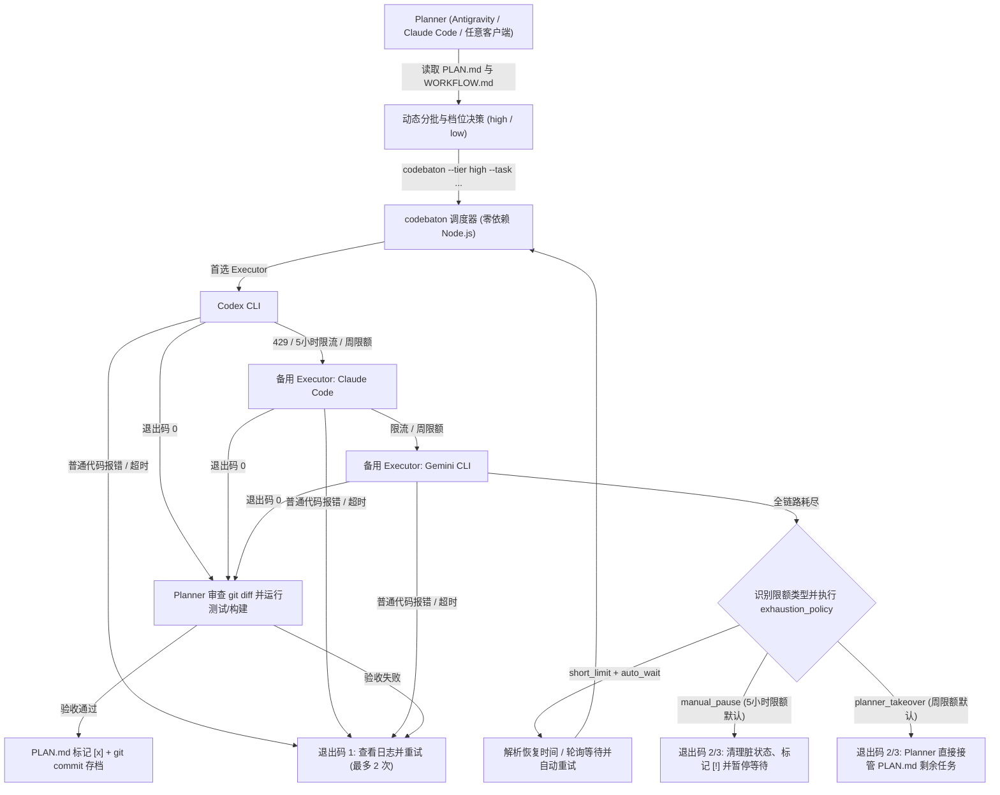

# codebaton

**Pass the coding baton across any AI CLI—with automatic failover and zero lost context.**

[English](README.md) | 简体中文

---

`codebaton` 是一个轻量级、**零外部依赖**、与客户端完全解耦的本地多智能体（**Planner + Executor**）接力调度框架。你可以将任意支持命令行/终端调用的 AI 编码工具（如 **Antigravity / Gemini**、**Claude Code**、**Codex CLI** 或自定义脚本）自由组合为 **规划验收者（Planner）** 与 **代码执行者（Executor）**，实现：

- **按复杂度动态分批派发**：高风险核心逻辑单步执行，低风险强关联样板 2~3 个打包执行。
- **按能力档位（`high` / `low`）动态路由模型**：屏蔽各家 CLI 模型命名差异，统一按档位调度。
- **分层限流识别与自动接力**：自动区分 **5 小时滚动/短周期限流（`short_limit`）** 与 **周限额/硬配额耗尽（`weekly_limit`）**，按 `executor_chain` 顺位交接。
- **三模式耗尽策略自由配置**：针对 5 小时限额和周限额分别支持 **`planner_takeover`（由 Planner 接手）**、**`manual_pause`（等待后手动继续）**、**`auto_wait`（时间到达自动重试继续）** 三种策略。
- **基于 Git 与 `PLAN.md` 的跨客户端断点续传**：随时切换不同 AI 客户端无缝接着干，零上下文丢失。
- **与项目原有 `AGENTS.md` / `CLAUDE.md` 安全共存**：三层防串台保护（幂等锚点追加、`[CODEBATON_EXECUTOR_MODE]` 身份前缀、硬递归环境变量锁），保留原有编码规范且杜绝死循环。

---

## 架构与接力流程图



---

## 快速开始

### 环境要求
- **Node.js ≥ 18**（零第三方 npm 依赖，`dependencies: {}`）
- **macOS 或 Linux** + `git`
- 本地已安装一个或多个 AI 编码 CLI（如 `codex`、`claude`、`gemini`）

### 1. 克隆并链接全局命令

```bash
git clone https://github.com/wenzhang1/codebaton.git
cd codebaton

# 无需 npm install！直接链接即可在任意项目中调用 codebaton
npm link
```

### 2. 零额度消耗体验内置 Mock 接力

```bash
# 模拟 Codex 触发 5 小时 429 限流 -> 自动接力给 Claude 执行成功（退出码 0）
codebaton --mock failover --tier high --task "实现 JWT 刷新中间件"

# 模拟全链路触发周限额 -> 退出码 3 + next_action=planner_takeover
codebaton --mock weekly-limit --tier high --task "执行数据库 Schema 迁移"

# 模拟 auto_wait 自动等待 1 秒后重试恢复 -> 退出码 0
codebaton --mock auto-wait --tier low --task "补充单元测试"
```

### 3. 一键初始化到你的目标项目

```bash
./scripts/init.sh /path/to/your-project --adapter all
# 可选适配器：--adapter antigravity | claude-code | all | none
```

`init.sh` 会安全完成以下操作：
- 生成 `codebaton.config.json`（已有文件默认跳过，不覆盖）
- 生成 `.codebaton/WORKFLOW.md`（标准化 Planner 工作流规范）
- 生成 `PLAN.md`（任务板与断点恢复日志模板）
- 安装 Antigravity 规则 `.agent/rules/codebaton.md`
- 以幂等锚点块（`<!-- codebaton:start --> ... <!-- codebaton:end -->`）追加到 `CLAUDE.md`，**100% 保留原有规则**，并按需写入 `.claude/settings.json` 权限白名单
- 自动将 `.codebaton/logs/` 和 `.codebaton/state.json` 追加到 `.gitignore`

### 4. 演练检查配置（Dry Run）

```bash
cd /path/to/your-project
codebaton --dry-run --tier high --task "验证执行链路与模型路由"
```

---

## 配置说明（`codebaton.config.json`）

完整示例见 [`codebaton.config.example.json`](codebaton.config.example.json)。

### 核心字段

```json
{
  "executor_chain": ["codex", "claude", "gemini"],
  "tiers": {
    "high": {
      "codex": "gpt-5.3-codex",
      "claude": "claude-opus-4-6",
      "gemini": "gemini-2.5-pro"
    },
    "low": {
      "codex": "gpt-5.1-codex-mini",
      "claude": "claude-sonnet-4-6",
      "gemini": "gemini-2.5-flash"
    }
  },
  "commands": {
    "codex": ["codex", "exec", "-m", "{{model}}", "{{task}}"],
    "claude": ["claude", "-p", "--model", "{{model}}", "{{task}}"],
    "gemini": ["gemini", "-p", "-m", "{{model}}", "{{task}}"]
  }
}
```

> **命令模板双格式安全兼容**：推荐使用**参数数组格式**（`shell: false` 直接传递参数，任务中包含多行代码块、引号、反引号、`$VAR` 也不会产生转义错误）；同时也兼容单行**字符串模板**（如 `"codex exec -m {{model}} \"{{task}}\""`），内部会自动安全分词或 POSIX 转义。

### 5 小时限额 vs 周限额：三模式耗尽策略配置

`codebaton` 会优先匹配 `weekly_limit_patterns`（周/月/余额硬配额），再匹配 `rate_limit_patterns`（5 小时滚动窗口/429/速率限制）。全链路耗尽时，按 `exhaustion_policy` 执行：

```json
"exhaustion_policy": {
  "short_limit": "manual_pause",
  "weekly_limit": "planner_takeover",
  "auto_wait": {
    "poll_interval_seconds": 900,
    "max_wait_seconds": 21600,
    "buffer_seconds": 30,
    "on_timeout": "manual_pause"
  }
}
```

`short_limit`（5 小时限额）和 `weekly_limit`（周限额）均支持以下 **3 个配置项**：

| 配置值 | 行为说明 | 适用场景 |
| :--- | :--- | :--- |
| **`"planner_takeover"`** | 输出 `next_action=planner_takeover`，通知当前 Planner 直接用原生能力接管剩余 `PLAN.md` 任务。 | **周限额默认推荐**（外部额度多日后才恢复，直接接管不中断交付） |
| **`"manual_pause"`** | 输出 `next_action=manual_pause` 与 `reset_hint`，Planner 清理半成品脏 diff、标记 `[!]` 并暂停，等额度恢复后由你手动恢复。 | **5 小时限额默认推荐**；也适合希望保护 Planner 自身额度的用户配给周限额 |
| **`"auto_wait"`** | 调度器自动从报错文本解析恢复时间（解析不到则按 `poll_interval_seconds` 轮询），在 `max_wait_seconds` 预算内自动休眠等待并重新执行；超时后按 `on_timeout` 兜底。 | 无人值守/过夜任务，希望 5 小时窗口一恢复就自动继续 |

### 命令行参数与退出码

| 参数 | 说明 |
| :--- | :--- |
| `--tier <high\|low>` | 指定能力档位（派发任务时必填） |
| `--task "<任务描述>"` | 内联任务文本 |
| `--task-file <路径\|->` | 从文件或标准输入（`-`）读取长任务 Prompt |
| `--executor <名称>` | 强制指定单个 Executor（不走链路接力） |
| `--config <路径>` | 指定自定义配置文件路径 |
| `--dry-run` | 仅打印解析后的链路、模型与命令，不实际执行 |
| `--mock [场景]` | 内置零消耗模拟（`failover`、`success`、`short-limit`、`weekly-limit`、`error`、`auto-wait`） |
| `--status` | 查看当前冷却状态（`.codebaton/state.json`）与策略配置 |
| `--reset-state` | 清空已记录的冷却期状态 |
| `--ignore-cooldown` | 本次执行忽略冷却期限制 |
| `--no-prefix` | 本次执行不附加 `executor_prompt_prefix` |

| 退出码 | 含义 |
| :---: | :--- |
| **`0`** | Executor 执行成功 |
| **`1`** | 普通执行失败（代码/编译报错、超时、配置错误或递归调用拦截）——**不触发盲目接力** |
| **`2`** | 全链路不可用/耗尽，且至少包含一个**短周期 / 5 小时限额** |
| **`3`** | 全链路所有可用 Executor 均命中**周限额 / 硬配额耗尽** |

退出码为 `2` 或 `3` 时，`stderr` 末尾会输出标准化的结构指令，供任意 Planner 精确解析：

```text
[codebaton] RESULT exit=3 limit_type=weekly_limit next_action=planner_takeover reset_hint="resets on Monday" executors=codex:weekly_limit,claude:weekly_limit,gemini:weekly_limit
```

---

## 与现有 `AGENTS.md` / `CLAUDE.md` 安全共存

当 Planner 在同一仓库内调用 `claude` 或 `codex` 作为 Executor 时，子进程会自动读取仓库内的 `AGENTS.md` / `CLAUDE.md`。`codebaton` 通过三层机制彻底避免覆盖与角色串台：

1. **无损初始化**：`scripts/init.sh` 永不覆盖已有 `CLAUDE.md`，仅在末尾追加/更新 `<!-- codebaton:start --> ... <!-- codebaton:end -->` 轻量指引块。
2. **Executor 身份前缀**：默认自动向子任务附加 `[CODEBATON_EXECUTOR_MODE]` 声明，指示 Executor 遵守仓库原有编码规范、直接修改代码，禁止修改 `PLAN.md`。
3. **硬防递归锁**：子进程自动注入 `CODEBATON_ROLE=executor` 与 `CODEBATON_DEPTH=1`，任何嵌套调用 `codebaton` 都会被立即拦截报错。

---

## 常见接力场景

1. **Antigravity 做 Planner → Codex / Claude / Gemini 接力执行**
   - Antigravity 维护 `PLAN.md`，复杂核心模块用 `--tier high`，样板与单测打包用 `--tier low`，每次完成自动跑 `git diff` + 测试并 `git commit`。
2. **Claude Code 做 Planner → Codex / Gemini 接力执行**
   - 使用 `--adapter claude-code` 初始化，Claude Code 专注架构把控与代码审查，重体力编码交由 Codex 与 Gemini 接力完成。
3. **5 小时限额等待 vs 周限额自动降级接管**
   - 仅触发 5 小时限额（退出码 `2`）：按配置默认暂停并在 `PLAN.md` 记录恢复提示（或设为 `auto_wait` 到点自动继续）。
   - 全部触发周限额（退出码 `3`）：默认下发 `next_action=planner_takeover`，Planner 无缝接手剩余任务直至交付。
4. **跨客户端断点续传**
   - 早上用 Antigravity 推进到 `T3` 并提交了 checkpoint，下午换 Claude Code 打开同一仓库，读取 `.codebaton/WORKFLOW.md` 与 `PLAN.md` 即可从 `T4` 无损续传。

---

## 扩展接入新的 AI CLI

接入任意新工具（如 Aider、OpenCode、Qwen Code 或自研 CLI）**无需修改一行源码**，只需在 `codebaton.config.json` 中增加配置：

```json
{
  "executor_chain": ["codex", "opencode", "claude"],
  "tiers": {
    "high": { "opencode": "openai/gpt-5.3" },
    "low":  { "opencode": "openai/gpt-5-mini" }
  },
  "commands": {
    "opencode": ["opencode", "run", "--model", "{{model}}", "{{task}}"]
  }
}
```

---

## 运行测试套件

运行包含 16 个核心场景的零 API 消耗自动化 Mock 测试：

```bash
npm test
# 或直接运行：
node tests/run-tests.mjs
```

---

## 开源协议

[MIT](LICENSE)
